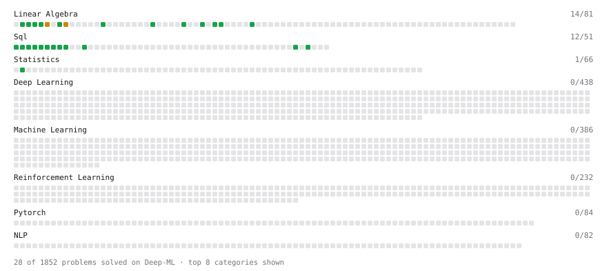

# Deep-ML

My machine learning practice from [Deep-ML](https://www.deep-ml.com). Every solution here was written by hand.

**40** solved · 34 problems · 0 labs · 6 math

[**Browse the interactive portfolio**](https://nkwquant-2024.github.io/deep-ml/) to replay this filling in over time.

## Problems

| | Difficulty | Solved | |
| --- | --- | --- | --- |
| [Add a Per-Group Average Column with GroupBy Transform](https://www.deep-ml.com/problems/1136) | easy | 2026-11-03 | [solution](problems/1136-add-a-per-group-average-column-with-groupby-transform) |
| [Average per group](https://www.deep-ml.com/problems/1108) | easy | 2026-10-31 | [solution](problems/1108-average-per-group) |
| [Calculate 2x2 Matrix Inverse](https://www.deep-ml.com/problems/8) | easy | 2026-10-19 | [solution](problems/0008-calculate-2x2-matrix-inverse) |
| [Calculate Mean by Row or Column](https://www.deep-ml.com/problems/4) | easy | 2026-10-17 | [solution](problems/0004-calculate-mean-by-row-or-column) |
| [Check Linear Independence of Vectors](https://www.deep-ml.com/problems/331) | easy | 2026-10-24 | [solution](problems/0331-check-linear-independence-of-vectors) |
| [Compute the Cross Product of Two 3D Vectors](https://www.deep-ml.com/problems/118) | easy | 2026-10-22 | [solution](problems/0118-compute-the-cross-product-of-two-3d-vectors) |
| [Convert Vector to Diagonal Matrix](https://www.deep-ml.com/problems/35) | easy | 2026-10-20 | [solution](problems/0035-convert-vector-to-diagonal-matrix) |
| [Count rows per group](https://www.deep-ml.com/problems/1107) | easy | 2026-10-31 | [solution](problems/1107-count-rows-per-group) |
| [Customers Who Never Placed an Order](https://www.deep-ml.com/problems/1460) | easy | 2026-10-31 | [solution](problems/1460-customers-who-never-placed-an-order) |
| [Delete Duplicate Emails Keeping One](https://www.deep-ml.com/problems/1112) | easy | 2026-10-31 | [solution](problems/1112-delete-duplicate-emails-keeping-one) |
| [Derivative of a Polynomial](https://www.deep-ml.com/problems/116) | easy | 2026-10-27 | [solution](problems/0116-derivative-of-a-polynomial) |
| [Descriptive Statistics Calculator](https://www.deep-ml.com/problems/78) | easy | 2026-10-21 | [solution](problems/0078-descriptive-statistics-calculator) |
| [Dot Product Calculator](https://www.deep-ml.com/problems/83) | easy | 2026-10-22 | [solution](problems/0083-dot-product-calculator) |
| [Filter rows with WHERE](https://www.deep-ml.com/problems/1103) | easy | 2026-10-29 | [solution](problems/1103-filter-rows-with-where) |
| [Handle Missing Data in pandas (dropna/fillna)](https://www.deep-ml.com/problems/1128) | easy | 2026-11-05 | [solution](problems/1128-handle-missing-data-in-pandas-dropna-fillna) |
| [Implement Orthogonal Projection of a Vector onto a Line](https://www.deep-ml.com/problems/66) | easy | 2026-10-22 | [solution](problems/0066-implement-orthogonal-projection-of-a-vector-onto-a-line) |
| [Matrix Determinant & Trace](https://www.deep-ml.com/problems/195) | easy | 2026-10-24 | [solution](problems/0195-matrix-determinant-trace) |
| [Monthly Average Product Rating](https://www.deep-ml.com/problems/1249) | easy | 2026-10-31 | [solution](problems/1249-monthly-average-product-rating) |
| [Remove duplicates with DISTINCT](https://www.deep-ml.com/problems/1105) | easy | 2026-10-31 | [solution](problems/1105-remove-duplicates-with-distinct) |
| [Reshape Matrix](https://www.deep-ml.com/problems/3) | easy | 2026-10-16 | [solution](problems/0003-reshape-matrix) |
| [Scalar Multiplication of a Matrix](https://www.deep-ml.com/problems/5) | easy | 2026-10-18 | [solution](problems/0005-scalar-multiplication-of-a-matrix) |
| [SELECT all rows](https://www.deep-ml.com/problems/1101) | easy | 2026-10-28 | [solution](problems/1101-select-all-rows) |
| [Select specific columns](https://www.deep-ml.com/problems/1102) | easy | 2026-10-29 | [solution](problems/1102-select-specific-columns) |
| [Sort results with ORDER BY](https://www.deep-ml.com/problems/1104) | easy | 2026-10-30 | [solution](problems/1104-sort-results-with-order-by) |
| [Top N with LIMIT](https://www.deep-ml.com/problems/1106) | easy | 2026-10-31 | [solution](problems/1106-top-n-with-limit) |
| [Transpose of a Matrix](https://www.deep-ml.com/problems/2) | easy | 2026-10-16 | [solution](problems/0002-transpose-of-a-matrix) |
| [Vector Element-wise Sum](https://www.deep-ml.com/problems/121) | easy | 2026-10-24 | [solution](problems/0121-vector-element-wise-sum) |
| [Your first JOIN](https://www.deep-ml.com/problems/1109) | easy | 2026-10-31 | [solution](problems/1109-your-first-join) |
| [Calculate Eigenvalues of a Matrix](https://www.deep-ml.com/problems/6) | medium | 2026-10-25 | [solution](problems/0006-calculate-eigenvalues-of-a-matrix) |
| [Employees Earning More Than Their Managers](https://www.deep-ml.com/problems/1113) | medium | 2026-11-02 | [solution](problems/1113-employees-earning-more-than-their-managers) |
| [Filter, Group, and Aggregate a DataFrame (Top-10 by Metric)](https://www.deep-ml.com/problems/1127) | medium | 2026-11-04 | [solution](problems/1127-filter-group-and-aggregate-a-dataframe-top-10-by-metric) |
| [Matrix times Matrix ](https://www.deep-ml.com/problems/9) | medium | 2026-10-26 | [solution](problems/0009-matrix-times-matrix) |
| [Nth-Highest Salary with Ties and NULL](https://www.deep-ml.com/problems/1110) | medium | 2026-11-01 | [solution](problems/1110-nth-highest-salary-with-ties-and-null) |
| [Top-3 Salaries Per Department](https://www.deep-ml.com/problems/1111) | medium | 2026-11-01 | [solution](problems/1111-top-3-salaries-per-department) |

## Math

| | Difficulty | Solved | |
| --- | --- | --- | --- |
| [Descriptive Statistics](https://www.deep-ml.com/math-problems/18) | easy | 2026-10-20 | [solution](math/0018-descriptive-statistics) |
| [Probability Fundamentals](https://www.deep-ml.com/math-problems/19) | easy | 2026-10-21 | [solution](math/0019-probability-fundamentals) |
| [Bayes' Theorem](https://www.deep-ml.com/math-problems/20) | medium | 2026-10-21 | [solution](math/0020-bayes-theorem) |
| [Common Distributions I: Bernoulli, Binomial, Uniform](https://www.deep-ml.com/math-problems/21) | medium | 2026-10-25 | [solution](math/0021-common-distributions-i-bernoulli-binomial-uniform) |
| [Common Distributions II: Normal, Poisson, Exponential](https://www.deep-ml.com/math-problems/22) | medium | 2026-10-25 | [solution](math/0022-common-distributions-ii-normal-poisson-exponential) |
| [Law of Large Numbers and Central Limit Theorem](https://www.deep-ml.com/math-problems/23) | medium | 2026-10-25 | [solution](math/0023-law-of-large-numbers-and-central-limit-theorem) |

---

_This file is regenerated by Deep-ML on every push._
